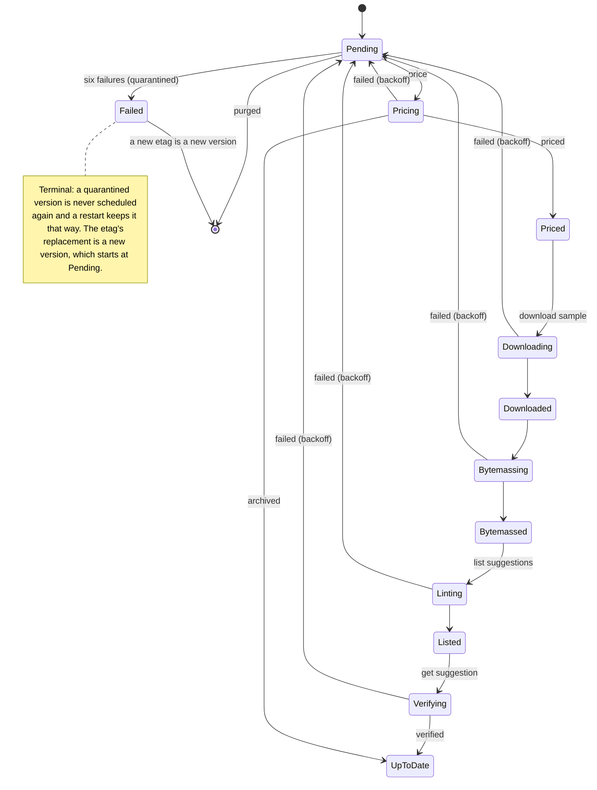

# Architecture

The rules that keep pqbench's commands decoupled, third-party code isolated,
and the dependency tree small. [`AGENTS.md`](../../AGENTS.md) covers naming and
tidyings; this page covers structure.

## Layers

- `crates/pqbench-model-v1` — the wire model: the resources, their name
  grammar (`v1::name`), and their JSON. `serde` only; it reads no file and
  speaks to no service, so it compiles in under a second. `pqbench` re-exports
  it as `pqbench::v1`.
- `crates/pqbench-parquet` — the local work: a footer's byte masses, page
  compression, the lint rules, a decoded profile. No network, no object store,
  no Delta, no Iceberg, so a change to a lint rule rebuilds one small crate.
  `pqbench` re-exports its modules at the same paths.
- `crates/pqbench` — the library's remote half: command implementations that
  read object storage, Delta, Iceberg, or Unity, their domain types, and the
  network third-party adapters.
- `crates/pqbench-cli` — a thin wrapper: argument parsing, the JSON documents,
  and output formatting. No command logic.
- `crates/pqbench-driver` — the partition-version state driver, a separate
  process (`pqbench-driver`) with its own socket and store. Its engine holds
  the map of partition versions and the driver runs the pqbench commands that
  move them; the CLI reads the map through `PQB_DRIVER_SOCK`.

## Commands

The walk's resource commands (`metastore`, `catalog`, `schema`, `table`,
`file`) are folders — one per resource, with a subcommand folder per verb. The
`credentials` folder is the vending implementation behind the daemon, not
a walk stage. The measurement commands (`bytemass`, `compression`, `lz`) keep an
`api.rs` and split the implementation across named modules; `profile`, `diff`,
and `skill` are single modules, and `summarize` is a small folder;
the library's `viz` renders the HTML page. The shared support (`report`, `mass`, `stats`, `time`, `config`,
`dialect`, `http`, `capability`, `codecs`) sits at the crate root. The CLI
adds the `daemon` command and its socket client; the library never opens a
socket.

```text
crates/pqbench/src/
  <resource>/
    <verb>/{api.rs, impl.rs, mod.rs}
  bytemass/{api.rs, collection.rs, remote.rs}
  third_party/
    <crate>/{api.rs, impl.rs, mod.rs}
    <crate>/impl/<module>.rs

crates/pqbench-parquet/src/
  lint/, compression/, profile.rs, codecs.rs, mass.rs, diff.rs
  third_party/
    <codec>/{api.rs, impl.rs, mod.rs}
```

- `api.rs` — the command's public entry point and the few helpers a caller
  needs. It is the whole public surface.
- `impl.rs` — the internals, private and free to change.

Rules:

- Every command stands on its own and is architected from above: its design
  starts at the public surface and shapes the implementation beneath it, never
  by lifting structure out of another command.
- A command is self-contained. It never imports another command and shares no
  implementation with one; repetition between commands is the accepted price of
  decoupling.
- A command folder never grows a utility module for other commands.
- Command code is always compiled. A missing capability is a runtime error, not
  a reason to remove code, so command code has no dead-code allowances.

## Resource hierarchy

Commands mirror the resource hierarchy of the data model — metastore, catalog,
schema, table, file. Each level's `list` module lists that level's resources
(the parent rides the argument, or parent refs on standard input); `get` reads
one resource.

## Partition-version states

`pqbench-driver` moves each `PartitionVersion` through the pipeline one command
at a time, and a price with nothing left to read stops it there.



## Interfaces

- The public surface is the command's entry point, and the less surface the
  better.
- Inputs are plain values the caller has. Configuration, pagination, and
  dialect state belong to the implementation, never to the signature.
- No abstractions in the public surface: no traits, no generic helpers, no
  shared protocol layer. Simple and readable beats clever and reusable.
- Where two implementations serve the same operation they keep the same shape,
  so dispatch stays flat.

## third_party

- One folder per third-party crate: `api.rs` is the isolated surface; `impl.rs`
  and its `impl/` submodules are the only code that names the crate. Feature
  flags live only under `impl`, enforced by `scripts/check_isolation.sh`.
- An adapter wraps a third-party crate and nothing else: no domain types, no
  other modules of the crate.
- Protocol code we speak ourselves is not third-party code, even when it runs
  over a third-party transport.
- The adapter mirrors only the minimal part of the dependency's interface that
  is needed.

## Features

- A command never adds a feature. Features map to third-party dependencies; a
  command reuses the feature that gates the dependency it needs.
- Code that does not name a third-party crate never sees a feature flag.
- CI builds one test leg per feature, and none for features with no distinct
  compilation behavior.

## Serialization

- The documents commands exchange are the CLI's communication language: the
  resource types live in `pqbench::v1` (the profile record is
  `pqbench::profile::ColumnProfile`), and the CLI renders them.
- Library commands take and return those resources; presentation stays in the
  CLI.
- The CLI parses an input document, calls one command function, and formats the
  result.

## Why

- Self-contained commands change, test, and ship independently.
- Duplication over coupling: a copied loop is cheaper than a shared module two
  commands must change together.
- A minimal public surface keeps signatures readable and internals free.
- One feature per dependency keeps the default build and the CI matrix small.
- Serialization in the CLI keeps the library independent of a presentation
  format.
