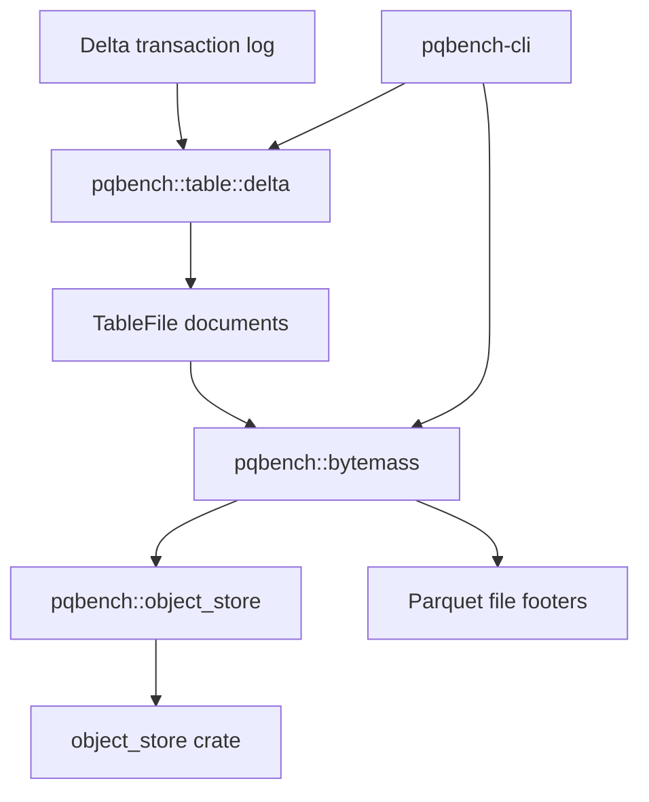

# Delta tables

The `pqbench` library contains an optional Delta Lake table module that detects
a Delta table, reads its transaction log, and names the active Parquet files.
Measurement is a separate step: `pqb ls files`
emits the files, and `pqb bytemass` reads them. Delta dependencies are
feature-gated and remain out of the default dependency graph.



`pqb ls files` names the format before it reads anything. `_delta_log` is
Delta and wins UniForm; Iceberg has its own loader. The Delta module uses
delta-rs to select a table snapshot and walks its active files.
It does not measure footers. The only module that names the `object_store` crate
is `pqbench::object_store`, which adapts it to the small `ObjectReader`
interface (`stat` + `read_range`) the rest of the crate uses.

## Usage

List the table's active files, then measure them. A terminal prints the files as
a table:

```console run delta
$ cat docker/e2e-lakehouse/table.ndjson | pqb ls files | pqb format
path                                                                 size_bytes
-------------------------------------------------------------------  ----------
part-00000-5eef9a52-f717-4d78-8e62-d7a2a05c707b-c000.snappy.parquet         796
```

Build with the feature when you run from source: name the table on stdin, e.g.
`echo '{"name":"catalogs/local/schemas/local/tables/events","uri":"./path/to/table"}' | cargo run -p pqbench-cli --features delta -- list files`, or run
the same command in a container.

Remote tables are resolved with `delta-s3` (which enables `aws`). Storage
A table's vended credentials travel as its `credentials` value (`AWS_*` keys);
they are not written into the process environment. The cargo command is
`echo '{"name":"catalogs/local/schemas/local/tables/events","uri":"s3://bucket/table"}' | cargo run -p pqbench-cli --features delta-s3 -- list files`.

A producer can supply the table URI and vended credentials as
a table record. `list files` reads the log, and the credentials travel to
`list files` and `bytemass`:

## Backends

S3 support is compiled behind the `aws` feature inside `pqbench::object_store`
(the only module that names the `object_store` crate). A URI whose backend is
not compiled in fails at runtime with a message naming the missing feature.
Adding another scheme is one arm in the factory plus one feature. The `delta`
feature flag gates the loader; its private `delta_helpers` module is the only
code that names the `deltalake` crate and is plain async. `pqb ls files`
drives a load on a current-thread runtime, so delta-rs selects its own executor
instead of borrowing the caller's.

## Document

`list files` resolves a snapshot and emits its **active** files as `TableFile`
records (name, blob, path, log size, logged modification time), each carrying
the table's lease; a file a later commit removed is absent. `bytemass` measures
each file as its line arrives and compares its size to the log. `--last` and
`--partition` keep only the files the log dates in a window. The stream is
NDJSON, and `>` captures it:

```console run delta
$ cat docker/e2e-lakehouse/table.ndjson | pqb ls files > /tmp/partition.ndjson
$ pqb bytemass < /tmp/partition.ndjson | pqb format
column  codec   encodings                 bytes  values
------  ------  ------------------------  -----  ------
id      SNAPPY  PLAIN,RLE,RLE_DICTIONARY     66       3
label   SNAPPY  PLAIN,RLE,RLE_DICTIONARY     72       3
```

## Memory use

With NDJSON output, `list files` emits each active file as it is read, without
retaining a second complete history or file list in the CLI. A write blocks when
the output buffer fills, so a slow consumer still slows the producer — per
buffer rather than per row, since a row's own write is a copy.

A metadata-only caller asks for the header with `LoadRequest::without_files()`:
the read resolves a plain delta-rs snapshot, which reads the log's actions but
never replays its files, so the load reports the snapshot version, schema,
partition columns, and properties at O(1) in files. `pqb get table` is that
caller.

Resolving a snapshot's *active files* uses delta-rs's lazy kernel snapshot and
its file view stream: the checkpoint and the commits after it are decoded a row
group at a time, and each file is written before the next is read, so memory is
one batch plus one file however large the table. `--last`/`--partition` test the
file's own logged time as it arrives. Memory also includes the largest
individual commit;
human table output buffers rows to align columns. The commit reads take their
versions from the log's own listing, so no version is probed and nothing below
retention is asked for, and each
commit is read as a header prefix, not whole
(1 KB, then 4 KB, whole only as a last resort), so a commit's add-list is neither
read nor retained. Reads run a window wide (`available_parallelism * 4`), so
memory is flat in the log's length rather than growing with every commit's
header. The library API retains the log and files it reads.

`list files` reads the snapshot, not a window's commits: the checkpoint and the
commits after it are scanned as add actions, and the window is applied to each
file's own logged time as it arrives. A file a later commit removed is absent,
and nothing below the checkpoint is read.

## Limitations

Data paths must stay inside the table root (no URIs, no `..`). A missing
`delta` feature fails at runtime and names the feature. Iceberg is detected
from `metadata/version-hint.text` or `metadata/*.metadata.json` and has its own
loader ([docs/iceberg.md](iceberg.md)).

## Dependencies

Delta resolution delegates to delta-rs 1.1.1, which requires Rust 1.94.1 or
newer. Delta dependencies are only built when the `delta` feature is enabled.
