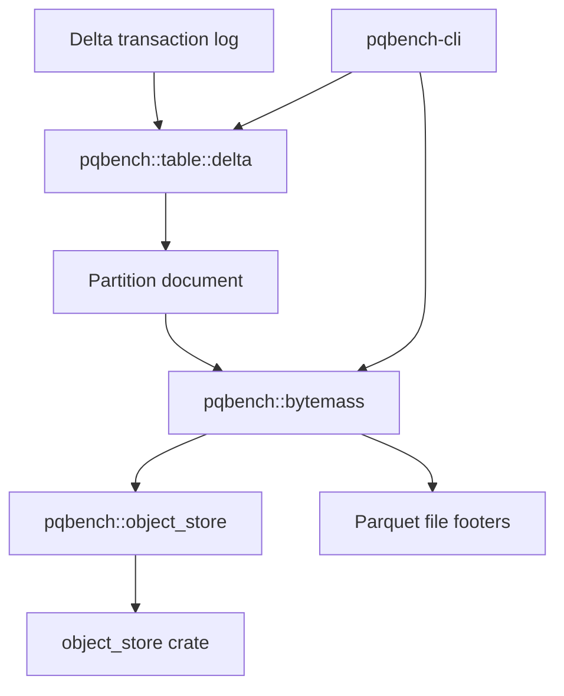

# Delta tables

The `pqbench` library contains an optional Delta Lake table module that detects
a Delta table, reads its transaction log, and names the active Parquet files.
Measurement is a separate step: `pqbench list partitions | pqbench list files`
emits the files, and `pqbench bytemass` reads them. Delta dependencies are
feature-gated and remain out of the default dependency graph.



`pqbench list partitions` names the format before it reads anything. `_delta_log` is
Delta and wins UniForm; Iceberg has its own loader. The Delta module uses
delta-rs to select a table snapshot and names each commit and its active files.
It does not measure footers. The only module that names the `object_store` crate
is `pqbench::object_store`, which adapts it to the small `ObjectReader`
interface (`stat` + `read_range`) the rest of the crate uses.

## Usage

List the table's natural partitions, then their files, then measure them. A
terminal prints the partitions as a table and a summary:

```console run delta
$ pqbench list partitions docker/e2e-lakehouse/table --format table
name                           first_time      last_time  commits
--------------------------  -------------  -------------  -------
catalogs/local/schemas/local/tables/table/partitions/1789862400000  1789862400000  1789948800000        1
partitions: 1
```

Build with the feature when you run from source, e.g.
`cargo run -p pqbench-cli --features delta -- list partitions ./path/to/table`, or run
the same command in a container.

Remote tables are resolved with `delta-s3` (which enables `aws`). Storage
A table's vended credentials travel as its `credentials` value (`AWS_*` keys);
they are not written into the process environment. The cargo command is
`cargo run -p pqbench-cli --features delta-s3 -- list partitions s3://bucket/table`.

A producer can supply the table URI and vended credentials as
a `remote-source` document. `list partitions` reads the log, and the credentials travel
to `list files` and `bytemass`:

## Backends

S3 support is compiled behind the `aws` feature inside `pqbench::object_store`
(the only module that names the `object_store` crate). A URI whose backend is
not compiled in fails at runtime with a message naming the missing feature.
Adding another scheme is one arm in the factory plus one feature. The `delta`
feature flag gates the loader; its private `delta_helpers` module is the only
code that names the `deltalake` crate and is plain async. `pqbench list partitions`
drives a load on a current-thread runtime, so delta-rs selects its own executor
instead of borrowing the caller's.

## Document

`Partition` groups a table's commits into an epoch-aligned
commit-time window: the window bounds, the commits (the Delta versions it
holds), and the table's storage root and lease. `list files` re-reads those
commits and emits the files they **added** as `TableFile` records (name,
blob, log size), each carrying the lease; a file a later commit removes is still
named. `bytemass` measures each file as its line arrives and compares its size
to the log. A terminal prints the files as a table and the summary (file count,
bytes); a pipe streams NDJSON. `--format json` forces the stream, and `-o`
also writes it without delaying stdout:

```console run delta
$ pqbench list partitions docker/e2e-lakehouse/table | pqbench list files -o /tmp/partition.ndjson.zst
$ pqbench bytemass /tmp/partition.ndjson.zst --format table
column  type        codec   encodings                 bytes  values
------  ----------  ------  ------------------------  -----  ------
id      INT64       SNAPPY  PLAIN,RLE,RLE_DICTIONARY     66       3
label   BYTE_ARRAY  SNAPPY  PLAIN,RLE,RLE_DICTIONARY     72       3
files: 1
rows: 3
columns: 2
```

## Memory use

With NDJSON output, `list partitions` emits each partition and `list files` each
available active file without retaining a second complete history or file list
in the CLI. Output writes are awaited, so a slow consumer slows the producer.

A metadata-only caller asks for the header with `LoadRequest::without_files()`:
the read resolves a plain delta-rs snapshot, which reads the log's actions but
never replays its files, so the load reports the snapshot version, schema,
partition columns, and properties at O(1) in files. `pqbench get table` is that
caller.

Resolving a snapshot's *active files* still goes through a loaded `DeltaTable`,
whose active-file replay delta-rs materializes before the first record; its lazy
file stream in the pinned version rejects malformed optional statistics that
the existing loader tolerates, so it is not a compatible replacement yet.
Memory also includes the largest individual commit and per-partition totals;
human table output buffers rows to align columns. The commit reads take their
versions from the log's own listing, so no version is probed and nothing below
retention is asked for, and read each commit as a header prefix, not whole
(1 KB, then 4 KB, whole only as a last resort), so a commit's add-list is neither
read nor retained. Reads run a window wide (`available_parallelism * 4`), so
memory is flat in the log's length rather than growing with every commit's
header. The library API retains the log
and files it reads.

## Limitations

Data paths must stay inside the table root (no URIs, no `..`). A missing
`delta` feature fails at runtime and names the feature. Iceberg is detected
from `metadata/version-hint.text` or `metadata/*.metadata.json` and has its own
loader ([docs/iceberg.md](iceberg.md)).

## Dependencies

Delta resolution delegates to delta-rs 1.1.1, which requires Rust 1.94.1 or
newer. Delta dependencies are only built when the `delta` feature is enabled.
