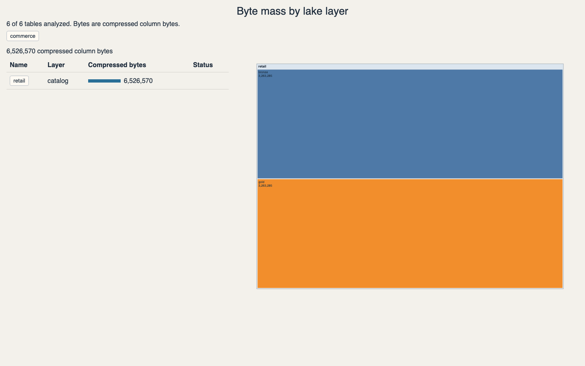
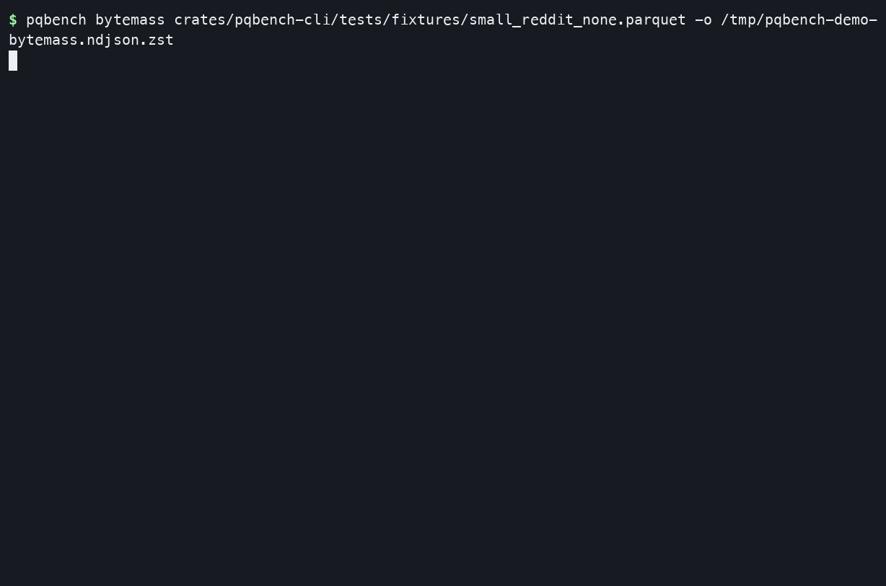
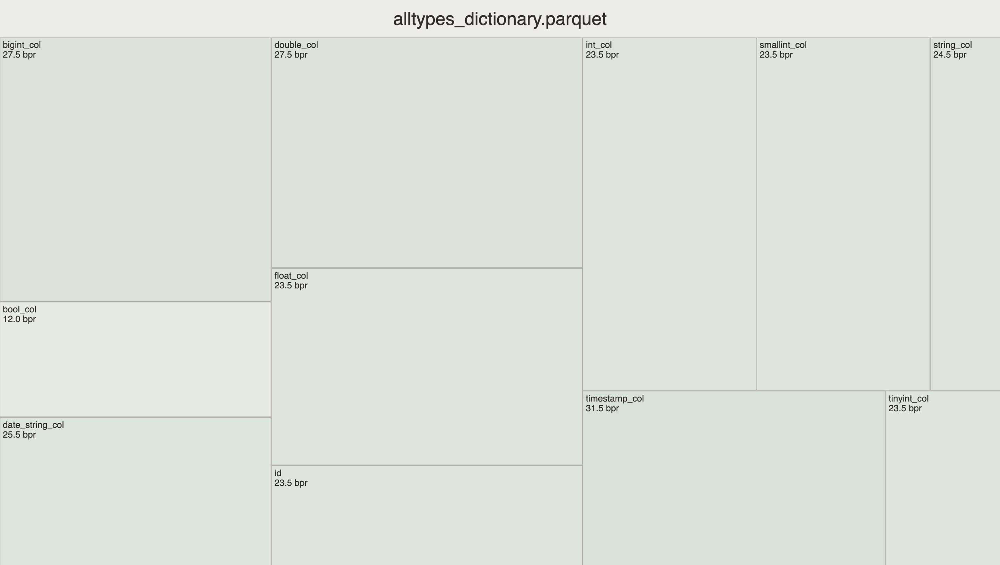
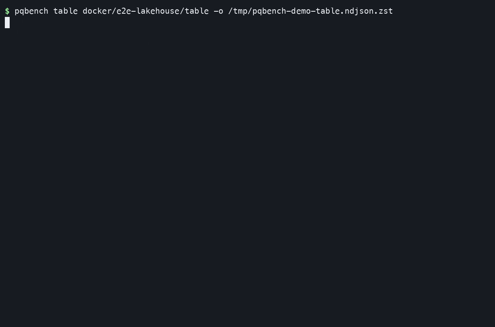
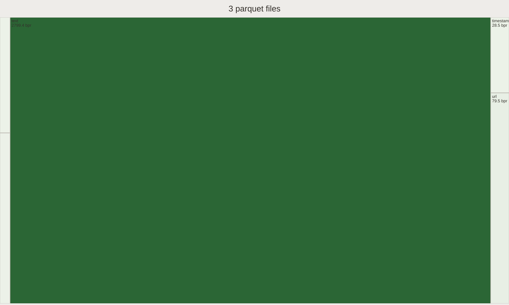

# Visual demos

pqbench measures Parquet footers. A file is one input. A table is a snapshot
of files. The pipe is the same in every case:

```console run
$ pqb table-file examples/quickstart.parquet | pqb bytemass | pqb fmt
column  codec         encodings                 bytes  values
------  ------------  ------------------------  -----  ------
id      UNCOMPRESSED  PLAIN,RLE,RLE_DICTIONARY    102       8
year    UNCOMPRESSED  PLAIN,RLE,RLE_DICTIONARY     68       8
$ pqb table-file examples/quickstart.parquet | pqb bytemass | pqb viz -o /tmp/report
```

Standard output is NDJSON (`Metastore`, `Catalog`, `Schema`, `Table`,
`TableFile`, `Blob`, `Bytemass`);
`pqb fmt` renders a table. `pqb viz` collects the bytemass stream into
a static HTML treemap.

The walkthroughs use the committed lakehouse fixtures under
[`docker/e2e-lakehouse/`](../../docker/e2e-lakehouse) and the small Parquet
fixture in the test suite. Catalog pipes need `make lakehouse`.

## Selecting files with Unix tools

`bytemass` measures the files the `list files` stream names; which files is a
shell decision. The stream is one JSON record per line, so `jq` prunes file
records by `name`, and `sort`, `head`, or `awk` sample by name:

```console run delta json
# one file: keep only the part-* records
$ cat docker/e2e-lakehouse/table.ndjson \
>   | pqb ls files \
>   | jq -c 'select(.name | contains("/files/part-"))' \
>   | pqb bytemass \
>   | jq -c 'select(.name | endswith("/bytemass")) | {column: (.name | capture("/columns/(?<c>[^/]+)/bytemass$").c), compressed_bytes}' | tail -1
{"column":"label","compressed_bytes":72}

# first N by name: sort the file records, cap them, then measure
$ cat docker/e2e-lakehouse/table.ndjson \
>   | pqb ls files \
>   | sort | head -10 \
>   | pqb bytemass \
>   | jq -c 'select(.name | endswith("/bytemass")) | {column: (.name | capture("/columns/(?<c>[^/]+)/bytemass$").c), compressed_bytes}' | tail -1
{"column":"label","compressed_bytes":72}

# every Nth file
$ cat docker/e2e-lakehouse/table.ndjson \
>   | pqb ls files \
>   | awk 'NR % 2 == 1' \
>   | pqb bytemass \
>   | jq -c 'select(.name | endswith("/bytemass")) | {column: (.name | capture("/columns/(?<c>[^/]+)/bytemass$").c), compressed_bytes}' | tail -1
{"column":"label","compressed_bytes":72}
```

The `list files` stream carries each file's `credentials` on the record, so
the lease travels with it through `jq`, `sort`, and `head`: `bytemass` reads the
file its `blob` names.

## A table's files

`list files` resolves a table's snapshot and names its active files, one
`TableFile` per line; `bytemass` reads each one's footer. The whole walk is two
commands:

```console run delta
$ cat docker/e2e-lakehouse/table.ndjson | pqb ls files | pqb bytemass | pqb viz -o /tmp/report
```



```console run delta
$ cat docker/e2e-lakehouse/table.ndjson | pqb ls files | pqb bytemass | pqb fmt
column  codec   encodings                 bytes  values
------  ------  ------------------------  -----  ------
id      SNAPPY  PLAIN,RLE,RLE_DICTIONARY     66       3
label   SNAPPY  PLAIN,RLE,RLE_DICTIONARY     72       3
```

## Catalogs

The catalog comes from the environment (`PQB_ENDPOINT`, `PQB_TOKEN`). The
dialect is declared, not probed: `PQB_TABLE_FORMAT` is `unity` (the default) or
`iceberg`. The walk descends `list catalogs` → `list schemas`
→ `list tables`, checks and vends credentials, then enriches each table and lists
its files:

```console no-run
$ export PQB_ENDPOINT=… PQB_TOKEN=…
$ echo '"CAT.SCHEMA"' | pqb ls tables |
    pqb credentials check |
    pqb credentials get |
    pqb get table |
    pqb ls files |
    pqb bytemass | pqb fmt
```

Every stage of a pipe writes NDJSON for the next stage; the last one prints the
table (`| pqb fmt`). The local stand (`make lakehouse`) exports
`PQB_ENDPOINT` and `AWS_*` for the walk. See
[docker/e2e-lakehouse/README.md](../../docker/e2e-lakehouse/README.md).

## One Parquet file

```console run
$ pqb table-file crates/pqbench-cli/tests/fixtures/small_reddit_none.parquet | pqb bytemass | pqb fmt
column            codec         encodings                  bytes  values
----------------  ------------  ------------------------  ------  ------
text              UNCOMPRESSED  PLAIN,RLE,RLE_DICTIONARY  743566    3000
label             UNCOMPRESSED  PLAIN,RLE,RLE_DICTIONARY    2469    3000
dataType          UNCOMPRESSED  PLAIN,RLE,RLE_DICTIONARY     360    3000
communityName     UNCOMPRESSED  PLAIN,RLE,RLE_DICTIONARY    2468    3000
datetime          UNCOMPRESSED  PLAIN,RLE,RLE_DICTIONARY      87    3000
username_encoded  UNCOMPRESSED  PLAIN,RLE,RLE_DICTIONARY  446197    3000
url_encoded       UNCOMPRESSED  PLAIN,RLE,RLE_DICTIONARY  907117    3000
```





## One Delta snapshot

`pqb ls files` needs `--features delta` to read a log. The stream is
NDJSON for `list files` and `bytemass`; `format` renders it:

```console run delta
$ cat docker/e2e-lakehouse/table.ndjson | pqb ls files | pqb bytemass | pqb fmt
column  codec   encodings                 bytes  values
------  ------  ------------------------  -----  ------
id      SNAPPY  PLAIN,RLE,RLE_DICTIONARY     66       3
label   SNAPPY  PLAIN,RLE,RLE_DICTIONARY     72       3
$ cat docker/e2e-lakehouse/table.ndjson | pqb ls files | pqb bytemass | pqb viz -o /tmp/report
```





## One Iceberg snapshot

Iceberg needs `--features iceberg` (`iceberg-s3` for `s3://`). The committed
fixture stores data as `s3://lakehouse/...`, so measure it through the stand
(`make lakehouse`), not just the feature:

```console no-run
$ cat docker/e2e-lakehouse/iceberg.ndjson | pqb ls files > /tmp/iceberg.ndjson
```

With the stand up, walk the Iceberg REST catalog (`PQB_ENDPOINT=…
PQB_TABLE_FORMAT=iceberg`) and measure through it: `list tables | credentials
check | credentials get | get table | list files | bytemass`.
`docs/demos/pqbench-iceberg-session.sh` runs the REST pipe when the stand answers
at `localhost:8181`.

## Regenerate the terminal recordings

Install `asciinema` and `agg`, then:

```sh
docs/demos/record.sh
```

That builds `pqbench` with `--features delta` (honoring `CARGO_TARGET_DIR`)
and records the Parquet and Delta sessions against committed fixtures.
The Iceberg REST pipe is not recorded here; it needs `make lakehouse`.

The table treemap GIF is one still of the viz page. Recapture it with
`docs/demos/capture-lake-treemap.sh` (Chrome + `ffmpeg`).
