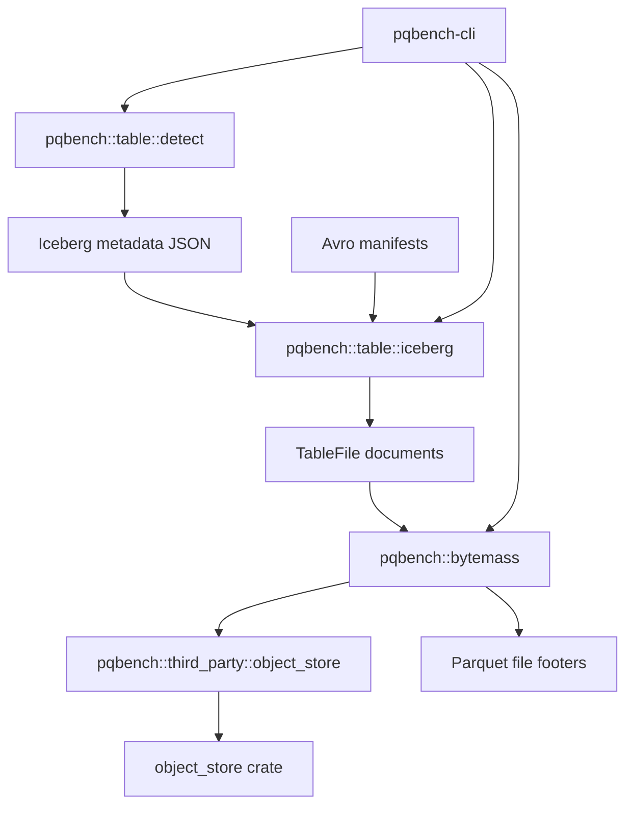

# Iceberg tables

The `pqbench` library contains an optional Iceberg table module that detects an
Iceberg table, loads its metadata JSON and Avro manifests, and names the active
Parquet files. Measurement is a separate step: `pqb ls files` emits the
files, and `pqb bytemass` reads them. Iceberg
dependencies are feature-gated and remain out of the default dependency graph.



`pqb ls files` names the format before it reads anything. Iceberg is
recognized from `metadata/version-hint.text`, `metadata/*.metadata.json`, or a
`.metadata.json` path. The loader reads that metadata and the snapshot's Avro
manifests.

Each manifest entry is decoded into the resource a reader compares: the file's
path and size, the partition values its `partition` record holds, its record
count, and the commit time of the snapshot that added it. A partition value is
formatted from its transform and its source column's type, so a `day` transform
reports a date (`2025-01-01`) and an `identity` decimal reports its scale
(`123.45`) — the record's own bytes never reach the output. Delete files are
data files' peers: `list files` names them in the log, `list partitions` counts
them per partition, and neither is measured as data. The only module that names
the `object_store` crate is `pqbench::third_party::object_store`.

Format versions 1, 2, and 3 are read: v2 adds delete manifests and snapshot
sequence numbers, v3 adds deletion vectors and nanoseconds, and each is a
superset of the version before it.

## Usage

List the current snapshot's active files. `pqb fmt` prints them as a table; a
pipe writes the full `TableFile` document. The URI may be a table root or the
metadata JSON itself. A file's time is the commit time of the snapshot that
added it, so `--last` selects the files added since a commit rather than the
moment the writer closed them.

A metadata-only caller asks for the header with `LoadRequest::without_files()`:
only the metadata JSON is read, so the load reports the snapshot version, schema,
partition columns, and properties at O(1) in files. (`pqb get table`
reads the same metadata inline from the REST `loadTable` response instead.)

The committed Iceberg fixture stores data as `s3://lakehouse/...`, so measuring
it needs the stand (`make lakehouse`), not just the `iceberg` feature. With the
stand up, `cat docker/e2e-lakehouse/iceberg.ndjson | pqb ls files |
pqb bytemass | pqb fmt` prints the same column table as this bare Parquet
file:

```console run
$ pqb table-file examples/quickstart.parquet | pqb bytemass | pqb fmt
column  type   codec         encoding  bytes  dict bytes  bytes/row  values
------  -----  ------------  --------  -----  ----------  ---------  ------
id      INT64  UNCOMPRESSED  dict        102          80      12.75       8
year    INT32  UNCOMPRESSED  dict         68          46       8.50       8
```

Two invocations under the `iceberg` cargo feature:

```sh
echo '{"name":"catalogs/local/schemas/local/tables/events","uri":"./path/to/table"}' \
  | cargo run -p pqbench-cli --features iceberg -- list files
echo '{"name":"catalogs/local/schemas/local/tables/events","uri":"./path/to/table/metadata/v1.metadata.json"}' \
  | cargo run -p pqbench-cli --features iceberg -- list files
```

Remote metadata and data objects are resolved with `iceberg-s3` (which enables
`aws`). A remote table root needs `metadata/version-hint.text`; otherwise pass
the metadata JSON URI:

```sh
echo '{"name":"catalogs/local/schemas/local/tables/events","uri":"s3://bucket/table"}' \
  | cargo run -p pqbench-cli --features iceberg-s3 -- list files
```

A producer supplies the table URI as a table record; `list files` reads the
snapshot, and `bytemass` reads the files under the lease the reader resolved. A
`catalogs/local/...` record is read with the ambient `AWS_*` environment,
because a catalog has nothing to vend for a path.

## Backends

S3 support is compiled behind the `aws` feature inside
`pqbench::third_party::object_store`.
A URI whose backend is not compiled in fails at runtime with a message naming
the missing feature. The Iceberg module itself contains no feature flags and no
third-party storage types.

## Partitions

`pqb ls partitions` folds the snapshot's active files into one record per
partition, from the metadata alone — no file is read. Each record carries the
partition's values, its file count, its bytes, its record count when every file
reports one, and its oldest and newest file by the adding snapshot's time.

A table that evolved its partitioning keeps writing files under the spec that
was current at the time. The partition columns are the default spec's fields
followed by any field only an older spec used, so every file's values are named
by one column list and no partition is left unnamed. A `void` field is not a
partition column: it is kept in a spec only so older files still resolve.

## Removed and delete files

Two kinds of storage a snapshot does not read as data are billed anyway.

**Removed files** are the data files the snapshot marks deleted (`status == 2`)
plus the data files only a retained older snapshot still names, which is what a
snapshot an expire has not yet dropped holds. `pqb ls partitions` reports them
per partition as `removed_file_count` and `removed_size_bytes`, and a file the
current snapshot still holds is never counted as removed, however many older
snapshots name it. A v2 or later manifest list reports how many entries each
manifest holds as deleted, so a table with one snapshot and no deleted entry
reads no manifest to report zero; a v1 list is read, since it does not say.
The fields are present for every Iceberg table either way, so a caller's record
has one shape.

**Delete files** are what merge-on-read applies: position deletes, equality
deletes, and a v3 deletion vector (a Puffin file). `pqb ls partitions` reports
them as `delete_file_count` and `delete_size_bytes`, and only when a partition
holds one, so a table that never deletes and a format without delete files
report nothing. Their bytes are mixed into the partition's `etag`, so rewriting
them invalidates a cached record.

`pqb ls suggestions` turns both into the rule that removes them:
`tombstones` for a table an expire has not finished, and `delete-files` for a
table a rewrite has not merged.

## Report

`pqb ls files` resolves the selected snapshot and names its active data
files. Delete files appear in the snapshot's actions. `pqb bytemass` then
reports
physical storage of those files: file bytes, physical Parquet rows, compressed
and uncompressed column bytes, codecs, and compressed bytes per row.

## Limitations

The implementation accepts Iceberg format versions 1, 2, and 3. It rejects
non-Parquet data files, data paths outside the table location, and active
files whose size differs from the manifest. Local path traversal and symlink
escapes are rejected. A delete file is counted and named, never decoded, so its
row-level deletes are not subtracted from the data files a scan would return.
No partial document is returned on failure.

## Dependencies

Snapshot planning reads metadata JSON with serde and Avro manifests with
apache-avro 0.17. Those dependencies are only built when the `iceberg` feature
is enabled; the manifest reader returns either the caller's own record type or
a format-agnostic value tree, so the crate that interprets a partition spec
names no Avro type.
