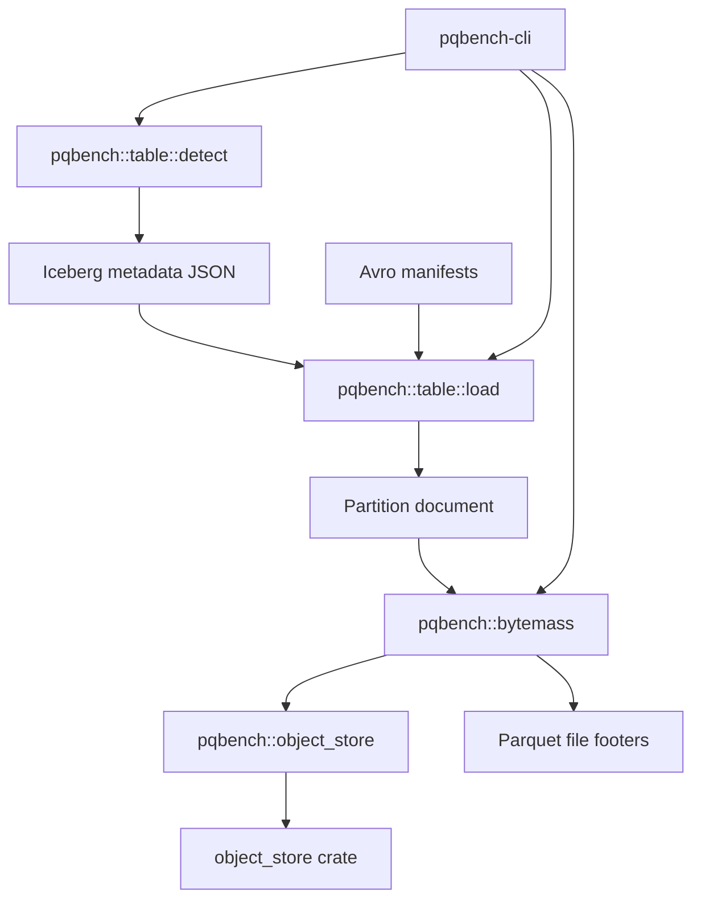

# Iceberg tables

The `pqbench` library contains an optional Iceberg table module that detects an
Iceberg table, loads its metadata JSON and Avro manifests, and names the active
Parquet files. Measurement is a separate step: `pqb ls files` emits the
files, and `pqb bytemass` reads them. Iceberg
dependencies are feature-gated and remain out of the default dependency graph.



`pqb ls files` names the format before it reads anything. Iceberg is
recognized from `metadata/version-hint.text`, `metadata/*.metadata.json`, or a
`.metadata.json` path. The loader reads that metadata and the snapshot's Avro
manifests. Delete files are named in the log and omitted from `files`. The only
module that names the `object_store` crate is `pqbench::object_store`.

## Usage

List the current snapshot's active files. `format` prints them as a table; a
pipe writes the full `TableFile` document. The URI may be a table root or the metadata JSON itself.
Iceberg records no per-file time, so `--last` and `--partition` are rejected here
rather than silently selecting nothing.

A metadata-only caller asks for the header with `LoadRequest::without_files()`:
only the metadata JSON is read, so the load reports the snapshot id, schema,
partition columns, and properties at O(1) in files. (`pqb get table`
reads the same metadata inline from the REST `loadTable` response instead.)

The committed Iceberg fixture stores data as `s3://lakehouse/...`, so measuring
it needs the stand (`make lakehouse`), not just the `iceberg` feature. With the
stand up, `cat docker/e2e-lakehouse/iceberg.ndjson | pqb ls files |
pqb bytemass | pqb format` prints the same column
table as a bare parquet:

```console run
$ pqb table-file examples/quickstart.parquet | pqb bytemass | pqb format
column  codec         encodings                 bytes  values
------  ------------  ------------------------  -----  ------
id      UNCOMPRESSED  PLAIN,RLE,RLE_DICTIONARY    102       8
year    UNCOMPRESSED  PLAIN,RLE,RLE_DICTIONARY     68       8
```

Two invocations from the `iceberg` cargo feature:

echo '{"name":"catalogs/local/schemas/local/tables/events","uri":"./path/to/table"}' \
  | cargo run -p pqbench-cli --features iceberg -- list files
echo '{"name":"catalogs/local/schemas/local/tables/events","uri":"./path/to/table/metadata/v1.metadata.json"}' \
  | cargo run -p pqbench-cli --features iceberg -- list files

Remote metadata and data objects are resolved with `iceberg-s3` (which enables
`aws`). A remote table root needs `metadata/version-hint.text`; otherwise pass
the metadata JSON URI:

echo '{"name":"catalogs/local/schemas/local/tables/events","uri":"s3://bucket/table"}' \
  | cargo run -p pqbench-cli --features iceberg-s3 -- list files

A producer can supply the table URI and vended credentials as
a table record; `list files` reads the snapshot, and the credentials
travel to `list files` and `bytemass`.

## Backends

S3 support is compiled behind the `aws` feature inside `pqbench::object_store`.
A URI whose backend is not compiled in fails at runtime with a message naming
the missing feature. The Iceberg module itself contains no feature flags and no
third-party storage types.

## Report

`pqb ls files` resolves the selected snapshot and names its active data
files. Delete files appear in the snapshot's actions. `pqb bytemass` then
reports
physical storage of those files: file bytes, physical Parquet rows, compressed
and uncompressed column bytes, codecs, and compressed bytes per row.

## Limitations

The implementation accepts Iceberg format versions 1 and 2. It rejects
non-Parquet data files, data paths outside the table location, and active
files whose size differs from the manifest. Local path traversal and symlink
escapes are rejected. Delete files are not applied. No partial document is
returned on failure.

## Dependencies

Snapshot planning reads metadata JSON with serde and Avro manifests with
apache-avro 0.17. Those dependencies are only built when the `iceberg` feature
is enabled.
