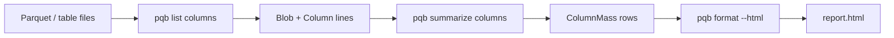

# Format

`format` reads an NDJSON stream on standard input. By default it renders one
table per record kind; `--html` draws a `summarize columns` stream as a static
treemap page on standard output. No other input is supported for `--html`.

```console run delta
$ pqb table-file examples/quickstart.parquet \
>   | pqb list columns \
>   | pqb summarize columns \
>   | pqb fmt
table                     column  bytes  values  bytes/value  ratio  files  class  $/month
------------------------  ------  -----  ------  -----------  -----  -----  -----  -------
local.quickstart.parquet  id        102       8        12.75   1.00      1
local.quickstart.parquet  year       68       8         8.50   1.00      1
$ pqb table-file examples/quickstart.parquet \
>   | pqb list columns \
>   | pqb summarize columns \
>   | pqb format --html > /tmp/report.html
$ cat docker/e2e-lakehouse/table.ndjson \
>   | pqb list files \
>   | pqb list columns \
>   | pqb summarize columns \
>   | pqb format --html > /tmp/report.html
```

Open `/tmp/report.html` in a browser; no server is needed. The page embeds the
rows and loads the d3 modules it uses from a CDN.



## Tables

Without `--html`, the stream becomes tables: one section per record kind,
columns from the curated type, and any record the type cannot hold rendered
from its own keys. A `ColumnMass` row has no `name`, so its shape places it in
a column-mass table: the table, the column, its bytes and values, bytes per
value, compression ratio, files, storage class, and monthly cost. A record with
no name and no summarized columns (a `diff` delta) is not table data.

```console run
$ pqb table-file examples/quickstart.parquet | pqb list columns | pqb format
column  type   codec         encoding  bytes  dict bytes  bytes/row  values
------  -----  ------------  --------  -----  ----------  ---------  ------
id      INT64  UNCOMPRESSED  dict        102          80      12.75       8
year    INT32  UNCOMPRESSED  dict         68          46       8.50       8
```

## HTML

The page opens one level at a time:

1. catalogs, sized by the on-disk bytes of their tables;
2. a catalog's schemas;
3. a schema's tables;
4. a table's columns, also labelled with bytes per row.

Every level's cell shows its compression ratio, uncompressed bytes over
compressed bytes (7.5×, not the compressed fraction the codec benchmarks
report), summed over the rows below it. The table cell counts the files of its
widest column; a row cannot carry the table's distinct file count, and the files
themselves are not drawn, because one table can carry thousands.

Click a cell to descend; the breadcrumb walks back up, and the hash keeps the
level, so a link can point at one. When a row carries a storage class, each
cell shows the estimated monthly S3 storage cost next to its bytes: an absent
class on S3 is STANDARD, a row's classes add, Intelligent-Tiering is a range
over its access sub-tiers, and local files are not priced. No build step, no npm, no local
server.

## Whole metastore

`make dbx-walk` runs the walk once against the live workspace and ends here. The
catalog levels cover every catalog; the table levels cover the one catalog the
principal may read outside compute (`PQB_WALK_CATALOG`, default `pqbench_ext`).

```console no-run
$ pqb list catalogs | pqb ratelimit --rate 15 \
>   | pqb list schemas | pqb ratelimit --rate 15 \
>   | pqb list tables | pqb ratelimit --rate 15 \
>   | jq -c 'select(.name | startswith("catalogs/pqbench_ext/"))' \
>   | pqb credentials check | pqb credentials get \
>   | pqb get table | pqb list files | pqb list columns \
>   | pqb summarize columns | pqb format --html > /tmp/metastore.html
```

One live run: 5 catalogs and 36 schemas (412 table refs); the `pqbench_ext`
refs (120) narrowed by `credentials check` to 91 tables in 11 schemas, 224
files, and 12,995 `Blob` and `Column` records folded into 1,726 `ColumnMass`
rows on a 434 KB page. The rows total 19,647,713,732 bytes against
19,651,902,193 on disk; the difference is Parquet footer and metadata, which no
column owns.

The other catalogs stop before storage: `samples` refuses `EXTERNAL USE SCHEMA`
to the walk's principal, `dbx_samples` is Databricks default storage, and
`workspace` and `system` are views and system tables. The `dbx-walk` CI job runs
the walk on every push and on non-draft pull requests from this repository; set
`PQB_WALK_PAGE` to keep the page, which otherwise stays in the script's temp
directory.
