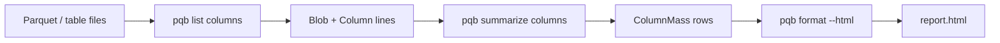

# Format

`format` reads an NDJSON stream on standard input. By default it renders one
table per record kind; `--html` draws a `summarize columns` stream as a static
treemap page on standard output. No other input is supported for `--html`.

```console run delta
$ pqb table-file examples/quickstart.parquet \
>   | pqb list columns \
>   | pqb summarize columns \
>   | pqb format --html > /tmp/report.html
$ cat docker/e2e-lakehouse/table.ndjson \
>   | pqb list files \
>   | pqb list columns \
>   | pqb summarize columns \
>   | pqb format --html > /tmp/report.html
```

Open `/tmp/report.html` in a browser; no server is needed. The page embeds the
rows and loads the d3 modules it uses from a CDN.



## Tables

Without `--html`, the stream becomes tables: one section per record kind,
columns from the curated type, and any record the type cannot hold rendered
from its own keys. A record with no `name` (a `diff` delta) is not table data.

```console run
$ pqb table-file examples/quickstart.parquet | pqb list columns | pqb format
column  type   codec         encoding  bytes  dict bytes  bytes/row  values
------  -----  ------------  --------  -----  ----------  ---------  ------
id      INT64  UNCOMPRESSED  dict        102          80      12.75       8
year    INT32  UNCOMPRESSED  dict         68          46       8.50       8
```

## HTML

The page opens one level at a time:

1. catalogs, sized by the on-disk bytes of their tables;
2. a catalog's schemas;
3. a schema's tables;
4. a table's columns, also labelled with bytes per row.

Every level's cell shows its compression ratio, uncompressed bytes over
compressed bytes (7.5×, not the compressed fraction the codec benchmarks
report), summed over the rows below it. The table cell counts the files behind
it; the files themselves are not drawn, because one table can carry thousands.

Click a cell to descend; the breadcrumb walks back up, and the hash keeps the
level, so a link can point at one. When a row carries a storage class, each
cell shows the estimated monthly S3 storage cost next to its bytes: an absent
class on S3 is STANDARD, Intelligent-Tiering is a range over its access
sub-tiers, and local files are not priced. No build step, no npm, no local
server.
