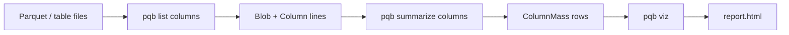

# Visualization

`list columns` measures Parquet footers and writes NDJSON. `summarize columns`
folds that stream into one row per table column, and `pqb viz` draws the rows
as a static HTML page. Measurement, aggregation, and presentation are separate
commands so either end can change without the others.

```console run delta
$ pqb table-file examples/quickstart.parquet \
>   | pqb list columns \
>   | pqb summarize columns \
>   | pqb viz -o /tmp/report
$ cat docker/e2e-lakehouse/table.ndjson \
>   | pqb list files \
>   | pqb list columns \
>   | pqb summarize columns \
>   | pqb viz -o /tmp/report
```

`-o report` writes `report.html` (here `/tmp/report.html`) and prints a short
summary. The HTML file embeds the rows; open it without a server.



## Stream

Each file is one `Blob` line and each column one `Column` line; `summarize
columns` turns those into one `ColumnMass` line per table and column path. A
row has no addressable `name` — it is a command document, not a resource — and
names its table and column as fields:

```json
{"table":"catalogs/sales/schemas/orders/tables/orders","column":"text","compressed_bytes":80,"uncompressed_bytes":240,"value_count":3000,"bytes_per_value":0.027,"compression_ratio":3.0,"file_count":1,"storage_classes":["STANDARD"],"storage_costs":[{"storage_class":"STANDARD","dollars_per_gibibyte_per_month":0.023,"cost_per_month":0.0000021}]}
```

The rows are weighted to the table: `summarize columns` divides each additive
field by the record's `sample_rate`, so a `sample files` stage yields an
estimate of the table, not of the sample. The cost is a list because HEAD
reports a class but not an access sub-tier; Intelligent-Tiering carries all
five sub-tiers, so a consumer can pick one. `pqb fmt` renders the rows as a
table.

`viz` does not reread or aggregate: it groups the rows by the table they name
and draws the hierarchy. A file measured by bare path takes the data model's
`local.local` table.

## HTML

The page embeds the hierarchy as JSON and loads the d3 modules it uses
(hierarchy, scale, selection) from a CDN. It opens one level at a time:

1. catalogs, sized by the on-disk bytes of their tables;
2. a catalog's schemas;
3. a schema's tables;
4. a table's columns, also labelled with bytes per row.

Every level's cell shows its compression ratio, uncompressed bytes over
compressed bytes (7.5×, not the compressed fraction the codec benchmarks
report), summed over the rows below it. The table cell counts the files behind
it; the files themselves are not drawn, because one table can carry thousands.

Click a cell to descend; the breadcrumb walks back up, and the hash keeps the
level, so a link can point at one. When a row carries a storage class, each
cell shows the estimated monthly S3 storage cost next to its bytes: an absent
class on S3 is STANDARD, Intelligent-Tiering is a range over its access
sub-tiers, and local files are not priced. No build step, no npm, no local
server.
