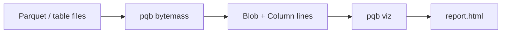

# Visualization

`bytemass` measures Parquet footers and writes NDJSON. `pqb viz` collects
those records into a static HTML page. Measurement and presentation are separate
commands so either end can change without the other.

```console run delta
$ pqb table-file examples/quickstart.parquet \
>   | pqb bytemass \
>   | pqb viz -o /tmp/report
$ cat docker/e2e-lakehouse/table.ndjson \
>   | pqb list files \
>   | pqb bytemass \
>   | pqb viz -o /tmp/report
```

`-o report` writes `report.html` (here `/tmp/report.html`) and prints a short
summary. The HTML file embeds the measured columns; open it without a server.



## Stream

Each file is one `Blob` line and each column one `Column` line. A column
measured through a table file names its table, so the page can place it in the
catalog hierarchy:

```json
{"name":"blobs/s3/table%2Fpart-0.parquet","size_bytes":1200,"row_group_count":1,"column_count":3}
{"name":"blobs/s3/table%2Fpart-0.parquet/columns/text","table":"catalogs/sales/schemas/orders/tables/orders","mass":{"compressed_bytes":80,"uncompressed_bytes":240,"codec":"ZSTD","value_count":3000}}
```

The `name`'s collection segment says what each record is (AIP-122), so no line
carries a `kind`. `viz` does not reread the files. A file measured by bare path
takes the data model's `local.local` table.

## HTML

The page embeds the hierarchy as JSON and loads the d3 modules it uses
(hierarchy, scale, selection) from a CDN. It opens one level at a time:

1. catalogs, sized by the on-disk bytes of their tables;
2. a catalog's schemas;
3. a schema's tables;
4. a table's columns, also labelled with bytes per row.

Every level's cell shows its compression ratio, uncompressed bytes over
compressed bytes (7.5×, not the compressed fraction the codec benchmarks
report), summed over the measurements below it. The table cell counts the
files behind it; the files themselves are not drawn, because one table can
carry thousands.

Click a cell to descend; the breadcrumb walks back up, and the hash keeps the
level, so a link can point at one. When the stream carries a file's storage
class, each cell shows the estimated monthly S3 storage cost next to its bytes:
an absent class on S3 is STANDARD, Intelligent-Tiering is a range over its
access sub-tiers, and local files are not priced. No build step, no npm, no
local server.
