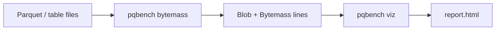

# Visualize a bytemass stream

`bytemass` measures Parquet footers and writes NDJSON. `pqbench viz` collects
those records into a static HTML page. Measurement and presentation are separate
commands so either end can change without the other.

```console run delta
$ pqbench table-file examples/quickstart.parquet | pqbench bytemass | pqbench viz -o /tmp/report
$ pqbench list partitions docker/e2e-lakehouse/table | pqbench list files | pqbench bytemass | pqbench viz -o /tmp/report
```

`-o report` writes `report.html` (here `/tmp/report.html`) and prints a short
summary. The HTML file embeds the measured columns; open it without a server.



## Stream

Each file is one `Blob` line and each column one `Bytemass` line:

```json
{"name":"blobs/s3/table%2Fpart-0.parquet","size_bytes":1200,"row_group_count":1,"column_count":3}
{"name":"blobs/s3/table%2Fpart-0.parquet/columns/text/bytemass","compressed_bytes":80,"uncompressed_bytes":240,"codec":"ZSTD","value_count":3000}
```

The `name`'s collection segment says what each record is (AIP-122), so no line
carries a `kind`. `viz` does not reread the files.

## HTML

The page embeds the columns and blobs as JSON and loads the d3 modules it uses
(hierarchy, scale, selection) from a CDN. JavaScript sums `compressed_bytes` per
column path and draws a treemap of on-disk bytes per value, plus a treemap of
file sizes. No build step, no npm, no local server.
